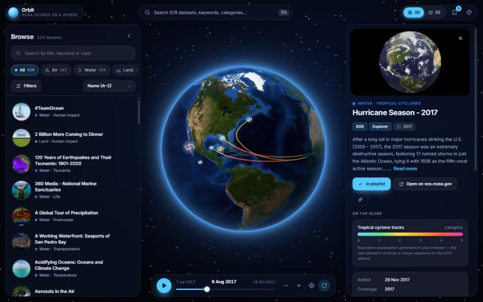

# SOS Catalog — 10 UI/UX Concepts

Ten standalone redesigns of the [NOAA Science On a Sphere dataset catalog](https://sos.noaa.gov/catalog/datasets/). Each concept explores a different way to search, filter, categorise, sort and view the catalog, with 2D and 3D globes, multiple themes and multiple layouts.

**Live preview:** https://sos-catalog-concepts.pages.dev



## What's inside

- **Real catalog data:** 528 datasets from `catalog.json`, with descriptions crawled from the dataset pages (see [src/raw](src/raw)). Thumbnails are hot-linked from sos.noaa.gov.
- **Self-contained concepts:** every file in [concepts](concepts) is a single HTML page with the engine, data and styles inlined. No runtime dependencies.
- **Shared globe engine:** a WebGL globe with 3D, 2D and a morph between them, several map projections, celestial bodies and procedural data layers.
- **Themes and layouts:** each concept ships with 3 themes and 3 layouts, is responsive down to 390px, and is keyboard accessible.

> The globe layers are illustrative procedural visuals, not real data.

## The concepts

| # | Concept | Idea |
|---|---------|------|
| 01 | Orbit | Immersive globe with glass panels, dark |
| 02 | Atlas | Editorial split view, paper-light, serif |
| 03 | Mission Control | Dense three-column console, monospace |
| 04 | Gallery | Streaming-style shelves and bento grid, light and vibrant |
| 05 | Constellation | Force-directed graph of datasets |
| 06 | Chronos | Timeline / Gantt chart alongside a map |
| 07 | Pocket | Mobile-first bottom sheet |
| 08 | Portal | Classic faceted grid in NOAA blue |
| 09 | Index | Swiss-style typographic list with hover preview |
| 10 | Studio | Playlist builder and presenter with multiple globes |

### Deep links

These work in every concept:

- `?theme=<name>` selects a theme
- `?layout=<name>` selects a layout
- `#<dataset-slug>` opens a dataset (e.g. `#hurricane-season-2017`)
- Constellation also accepts `?group=network|category|theme|year|kind|platform`

## Getting started

Requires Node.js. There are no dependencies to install.

```bash
# Build everything
node src/build.js

# Build only specific concepts by file-name prefix
node src/build.js 03 05

# Serve the repo locally (default port 5183)
node src/tools/serve.js
```

Then open `index.html` (the gallery) or any file in `concepts/`.

The build inlines `src/shared/*` and the generated data into each template in `src/concepts/` and writes the result to `concepts/`. Templates starting with `_` are dev pages and are written to `dev/`.

## Project layout

```
index.html          Gallery of all concepts
concepts/           Built, standalone concept pages
assets/shots/       Hero screenshots (800×500)
dev/                Dev and QA pages (engine sheet, frame, qa, contrast, a11y)
src/
  build.js          Template inliner
  concepts/         Concept templates
  raw/              Source catalog, descriptions, thumbnails
  generated/        Output of the data pipeline
  shared/           Engine, store, layers, UI helpers, base CSS
  tools/            Data preparation and local server
```

## Shared code

Files in `src/shared` are concatenated in this order, so order matters:

| File | Provides |
|------|----------|
| `00-core.js` | Utilities, geo data, QA hook, `?rafshim` |
| `10-store.js` | `SOS.store`: hydration, search / facets / sort, playlist |
| `20-layers.js` | `SOS.layers`: layer ramps and legends, bodies, overlays, particles |
| `30-shaders.js` | GLSL shaders |
| `31-globe.js` | `SOS.Globe` |
| `40-ui.js` | `SOS.ui`: icons, thumbs, toasts, persistence, theme switcher, segmented control |
| `50-app.js` | `SOS.createApp`, `SOS.describe`, `SOS.bindGlobe` |

Two helpers run automatically:

- `fitPlaceholders` shortens an `<input placeholder>` to whole words plus "…" when the field is too narrow. The original text is kept in `data-ph`.
- `bindScrollFade` adds an edge fade to `[data-fade]` horizontal strips on whichever side still has content.

### Globe API

```js
new SOS.Globe(el, {
  mode: '3d',             // '3d' | '2d'
  projection: 'equirect', // 'equirect' | 'natural' | 'mercator'
  wrap, lon, lat, zoom, autoRotate,
  onView, onHover, onClick, onTime, onReady
});
```

Methods: `setMode`, `setProjection`, `setDataset(d, {fly, dur})`, `setTime(t)`, `play(bool)`, `setLoop(s)`, `setLayerOpacity`, `setInsets({l,r,t,b})`, `flyTo(lon, lat, zoom)`, `zoomBy(f)`, `resetView()`, `project()`, `unproject()`.

Theming: `themeFromCSS(el)` reads the `--g-*` custom properties: `--g-style` (`photo|flat|duo|dots`), `--g-ocean`, `--g-ocean2`, `--g-land`, `--g-land2`, `--g-coast`, `--g-coast-a`, `--g-grid`, `--g-grid-a`, `--g-grid-step`, `--g-atmo`, `--g-atmo-a`, `--g-stars`, `--g-light` (`head|sun|none`), `--g-exposure`, `--g-sat`, `--g-gamma`, `--g-night`, `--g-lights`, `--g-text`, `--g-halo` and `--g-accent`.

Layer kinds live in `SOS.layers.LAYERS`: sst, temp, clouds, precip, aerosol, co2, ice, bathy, veg, chloro, pop, tsunami, ozone, aurora, magnetic, insol, lights, topo, wind, currents, fire, acid, quakes, storms, routes, energy, earth. Also supported are bodies (`body:moon`, …) and skies (`sky:cmb`, `sky:milky`). Because the layers are illustrative, say so in the UI footer or about text.

## Development and QA

### Dev pages

- `dev/engine.html?rafshim&sheet=sst,clouds,body:moon&cols=3&mode=3d|2d&proj=natural&style=dots|paper|flat|duo&wrap=0` renders a contact sheet of mini globes.
- `dev/frame.html?c=02-atlas&w=1280&h=800&v=1&q=layout=split&theme=paper#slug` shows a concept in an iframe of a given CSS size, scaled to fit the window. Change `v` after a rebuild to bypass caching.

### Automated checks

| Page | Checks | Status |
|------|--------|--------|
| `dev/qa.html?mode=all&auto=1` | Loads every concept × theme/layout (1360×800) and every layout at 390×780. Reports uncaught errors, `console.error`, horizontal overflow and missing canvases. Add `&hash=<slug>` to run with a dataset selected. Results in `window.__qa`. | 0 errors across 90 loads, plain and with a dataset |
| `dev/contrast.html?auto=1[&w=390&h=800]` | Measures WCAG contrast of on-screen text and placeholders in every concept × theme. Results in `window.__contrast`. | 0 failures in 120 states |
| `dev/a11y.html?auto=1` | Checks unnamed buttons/links, unlabeled inputs, missing alt text, duplicate ids, positive tabindex, dangling `aria-*` references, and lang/title/viewport/h1. | Clean |

The QA matrix only catches errors and overflow, so also check each layout by eye at phone width and at 1280px.

Palette rule of thumb: tertiary text (`--faint`) must reach 4.5:1 on every surface of its theme. For category-coloured text on light themes use `color-mix(in srgb, var(--c) 70%, var(--ink))`, and don't dim text with `opacity`.

### Tips for the hidden browser pane

- Add `?rafshim` to a page URL when `requestAnimationFrame` doesn't fire. It switches to a timer-driven rAF and disables transitions, animations and smooth scroll. Take screenshots after a short wait.
- Screenshots lag one frame behind state changes, so take a second one. If one looks zoomed or tiny, resize the window again or use `dev/frame.html`.
- A hash-only navigation does not reload the page. Visit another URL first.
- Use the bundled Node server. Python's `http.server` can't see this path because of Store-Python AppData virtualization.

### Gotchas

- Avoid generic class names shared between components. A legend `.bar` once collided with the Gantt `.bar`.
- `ui.segmented()` needs `[data-value]` on its items.
- Don't use `content-visibility: auto` on rows. It caused paint artefacts outside the scroll container.
- `html[data-layout=x] .app { grid-template-columns: … }` beats a plain `.app { … }` inside a media query. Repeat the layout selector in the responsive rule.

## License

See [LICENSE](LICENSE).
